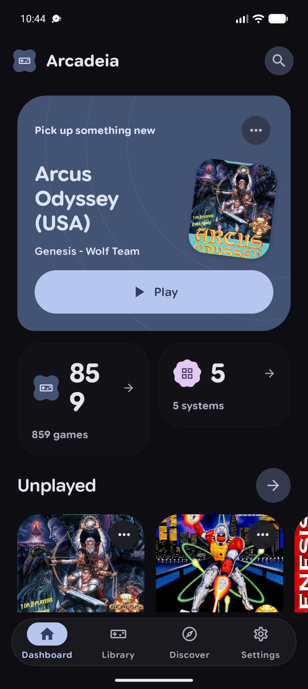
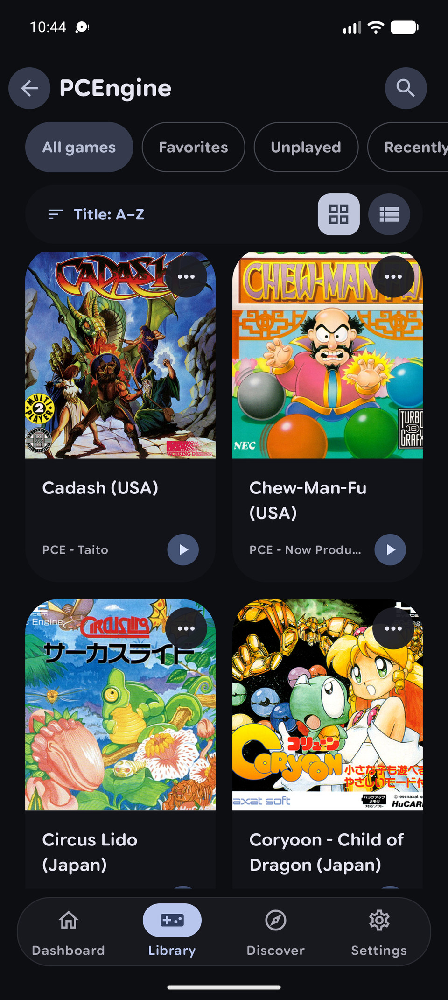
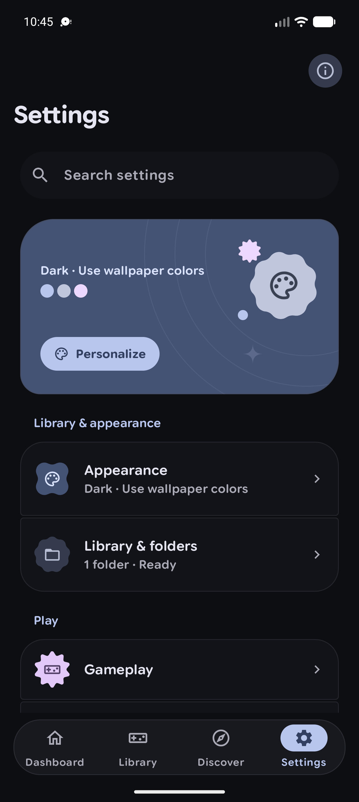

<div align="center">


# Arcadeia 🎮

**Your games, systems, and emulators in one place.**

An open-source Android frontend for local game libraries, Libretro cores, and standalone emulators.

[Features](#features) · [Systems](#supported-systems) · [Download](#download) · [Build](#build) · [Credits](#credits)


</div>

<table align="center">
  <tr>
    <td width="33%"></td>
    <td width="33%"></td>
    <td width="33%"></td>
  </tr>
  <tr>
    <td align="center"><sub>Home</sub></td>
    <td align="center"><sub>Library</sub></td>
    <td align="center"><sub>Settings</sub></td>
  </tr>
</table>

## Features

### One library for your games

- Identify systems from ROM folders before inspecting filenames, using familiar [ES-DE folder conventions](docs/ROM_FOLDER_GUIDE.md).
- Browse by system, search, and organize games with favorites, collections, and play history.
- Enrich your library with cover art and metadata from [ScreenScraper](https://www.screenscraper.fr/), [IGDB](https://api-docs.igdb.com/), and [TheGamesDB](https://thegamesdb.net/).
- Discover games in a native catalog that combines matching records from configured metadata sources. Browsing does not require a ROM folder.

Provider setup varies: TheGamesDB uses your API key, ScreenScraper requires its account and access setup, and IGDB needs a configured proxy.

### Play with the right emulator

- Run supported systems with bundled [Libretro](https://www.libretro.com/) cores.
- Launch compatible games in [ARMSX2](https://github.com/ARMSX2/ARMSX2) or [NetherSX2 Classic](https://github.com/Trixarian/NetherSX2-classic) for PlayStation 2, [Eden](https://git.eden-emu.dev/eden-emu/eden) for Switch, and [Azahar](https://github.com/azahar-emu/azahar) for Nintendo 3DS.
- Find compatible emulator releases in Arcadeia's emulator manager; Android asks before installing another app.
- Use touch controls, gamepads, or the Android TV interface.

### Saves and a personal look

- Use save states, autosaves, and optional cloud sync with supported Libretro cores.
- Keep exported Eden title saves and PS2 memory-card files in Arcadeia's portable save vault for user-managed export and restore.
- Choose Material 3 Expressive styling, optional wallpaper colors, and a pure-black AMOLED theme.

## Supported systems

| Emulation route | Systems |
| --- | --- |
| **Libretro cores** | Atari 2600, 7800, Lynx; NES, SNES, Game Boy, Game Boy Color, Game Boy Advance, Nintendo 64, Nintendo DS; Genesis, Master System, Game Gear, Sega CD; PlayStation, PSP; FinalBurn Neo, MAME 2003 Plus, PC Engine, Neo Geo Pocket, WonderSwan, DOS; Nintendo 3DS with a compatible core. |
| **External emulators** | PlayStation 2 · Nintendo Switch · Nintendo 3DS |

External emulator compatibility depends on the installed emulator version, device hardware, and game format. See the [compatibility matrix](docs/EXTERNAL_EMULATOR_COMPATIBILITY.md) for tested paths and known limits.

Discover is a metadata catalog, not a ROM download service. Arcadeia does not include or distribute ROM or BIOS files.

## Download

Check [GitHub Releases](https://github.com/Reventoire/Arcadeia/releases) for an APK. There is no public APK release yet; you can build the app from source below.

## Build

Requirements: Android SDK and JDK 17.

```sh
git clone --recurse-submodules https://github.com/Reventoire/Arcadeia.git
cd Arcadeia
./gradlew :arcadeia-app:assembleFreeDynamicDebug
```

The Android app supports API 23 and newer. On Windows, use `gradlew.bat` in place of `./gradlew`.

## Project modules

| Module | Purpose |
| --- | --- |
| `arcadeia-app` | Android app, screens, navigation, and settings |
| `arcadeia-app-shared` | Shared application features and Libretro runtime |
| `arcadeia-core-bundle` | Libretro core integration |
| `arcadeia-app-ext-free` · `arcadeia-app-ext-play` | Distribution-specific app integrations |
| `arcadeia-metadata-libretro-db` · `arcadeia-touchinput` · `arcadeia-util` | System metadata, controls, and shared utilities |

## Guides

[ROM folder setup](docs/ROM_FOLDER_GUIDE.md) · [External emulator compatibility](docs/EXTERNAL_EMULATOR_COMPATIBILITY.md) · [Discover and metadata](docs/DISCOVERY_CATALOG.md) · [Save compatibility](docs/SAVE_COMPATIBILITY.md) · [Technical roadmap](docs/TECHNICAL_ROADMAP.md)

## Credits

Arcadeia began as a fork of [Lemuroid](https://github.com/Swordfish90/Lemuroid) and uses [LibretroDroid](https://github.com/Swordfish90/LibretroDroid). Folder recognition follows [ES-DE](https://github.com/ES-DE/ES-DE) conventions. External emulator handoff uses the projects linked above.

Metadata integrations: [ScreenScraper](https://www.screenscraper.fr/), [IGDB](https://api-docs.igdb.com/) via [igdbclient](https://github.com/illarionov/igdbclient), and [TheGamesDB](https://thegamesdb.net/). Some providers require user credentials or additional service configuration.

The interface draws on studies of [PixelMusic](https://github.com/Xing1P/PixelMusic) and [PixelPlayer](https://github.com/PixelPlayerHQ/PixelPlayer).

Arcadeia is licensed under [GPL-3.0](COPYING). Third-party notices and licenses are in [`licenses/`](licenses/). Emulator names and trademarks belong to their respective owners; Arcadeia is an independent frontend.
